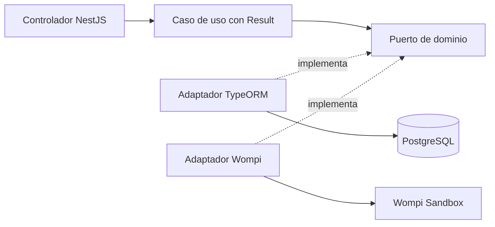

# Blush Atelier API

Backend de la prueba Full Stack: NestJS, TypeScript, PostgreSQL y TypeORM.
Frontend independiente: [blush-atelier-web](https://github.com/blush-atelier/blush-atelier-web).
Incluye catálogo, carrito de varios productos, cliente, entrega, cotización y una transacción PENDING con reserva atómica de stock.
La integración Wompi Sandbox está implementada: aprobación y rechazo se comprobaron
contra UAT mediante adaptadores y API local; faltan E2E en navegador y validación AWS.
Wompi se usará exclusivamente en Sandbox en todos los ambientes.

## Ejecutar localmente

Requisitos: WSL Ubuntu, Node 22.23.3 (`.nvmrc`) y Docker Compose disponible en WSL.
Ejecuta desde la raíz del repositorio:

```bash
nvm use
npm ci
cp .env.example .env
```

Completa `.env` así y elige tu usuario y contraseña locales en los dos campos vacíos:

```dotenv
NODE_ENV=development
PORT=3000
FRONTEND_ORIGIN=http://localhost:5173
POSTGRES_HOST=localhost
POSTGRES_PORT=5433
POSTGRES_DB=blush_atelier
POSTGRES_USER=
POSTGRES_PASSWORD=
POSTGRES_SSL=false
```

`.env` no se versiona. Luego levanta PostgreSQL, crea las tablas, carga productos y arranca la API:

```bash
docker compose up -d db
docker compose ps
npm run local:migrate
npm run local:seed
npm run local:dev
```

Espera a que `db` aparezca como `healthy` antes de ejecutar la migración.
Los comandos local:* detectan la IP actual del contenedor en WSL sin modificar .env.
El seed carga 20 productos reales (MAC, Too Faced, Bloomshell y Atenea) con precios de referencia COP y fotos, además de los 2 ficticios previos; inventario de demostración. Se puede repetir sin reiniciar stock ni precios. [Fuentes](docs/decisions-and-interview-notes.md#catálogo-de-demostración--13112026). `docker compose down` detiene la BD conservando el volumen.
[Guía local y solución de errores](docs/development.md).

## Probar con Swagger

Abre [http://localhost:3000/docs](http://localhost:3000/docs).
Expande un endpoint, pulsa **Try it out** y luego **Execute**. Los productos son públicos; el checkout usa una cookie HttpOnly creada al registrar el cliente.

| Método | Endpoint                               | Función                                            |
| ------ | -------------------------------------- | -------------------------------------------------- |
| GET    | `/api/products` y `/api/products/{id}` | Catálogo y stock disponible                        |
| POST   | `/api/customers`                       | Registrar comprador y crear cookie de sesión       |
| POST   | `/api/deliveries`                      | Guardar entrega para esa sesión                    |
| POST   | `/api/checkout/quote`                  | Cotizar sin reservar                               |
| POST   | `/api/transactions`                    | Crear PENDING y reservar con Idempotency-Key       |
| GET    | `/api/transactions/{id}`               | Reanudar y consultar el estado de la propia compra |

En cada POST usa `X-Checkout-Request: 1`. Swagger muestra la cabecera; registra primero
el cliente para que el navegador guarde la cookie. No introduzcas tarjetas en Swagger. La tarjeta se cifra y tokeniza desde el navegador directamente con Wompi.
[Ejemplos para probar el flujo](docs/checkout-testing.md).

UUID inválido: 400; producto inexistente: 404; almacenamiento no disponible: 503.
Contrato OpenAPI: [http://localhost:3000/docs-json](http://localhost:3000/docs-json).
Swagger ya está configurado; sus rutas no llevan el prefijo `/api`.

## Arquitectura y modelo de datos



Organización por módulo: `domain`, `application` e `infrastructure`.
Dominio y aplicación no dependen de NestJS ni TypeORM; el controlador traduce Result a HTTP.
La reserva y la transacción se guardan juntas; una clave repetida no duplica stock.
Las reservas sin pago vencen en 15 minutos; su liberación se evalúa al cotizar, crear
o consultar transacciones. Cada pedido conserva sus líneas en `transaction_items`; las tarifas se aplican una sola vez.
[Decisiones y notas para entrevista](docs/decisions-and-interview-notes.md).

`payments/domain` decide transiciones con Result; `application` prepara/verifica pagos
y procesa eventos; `infrastructure` implementa Wompi, HTTP y persistencia. La llamada
al proveedor queda fuera del bloqueo DB; la confirmación/liberación de todas las líneas
y la entrega se guardan atómicamente. Duplicados no repiten el movimiento de stock.


Disponibilidad = `stock_on_hand - stock_reserved`. Los importes son centavos:
`BIGINT` en PostgreSQL, `bigint` para cálculos y string en JSON;
`"8990000"` representa 89.900,00 COP.
[ERD Mermaid](docs/erd.mmd), [diccionario de datos](docs/data-dictionary.md) y
[modelo futuro de checkout y relaciones](docs/checkout-model.mmd).

## Pruebas

```bash
npm run format:check
npm run lint
npm run typecheck
npm run test:cov
npm run build
```

Resultado medido: **206 pruebas unitarias/HTTP y 39 de integración PostgreSQL correctas**.
Cobertura Jest del backend: sentencias **93,71%**, ramas **90,04%**,
funciones **85,94%** y líneas **93,67%**; umbral obligatorio configurado en 81%.
La integración usa una base desechable separada: [cómo ejecutarla](docs/development.md#pruebas-de-integración).
[Evidencia y limitaciones](docs/verification.md). El frontend mide su cobertura en su propio repositorio.

## CI/CD y entrega

Promoción por PR: `feature/* → development → staging → production`.
Development es local; staging valida; production será la entrega AWS.
GitHub Actions configura instalación, formato, lint, typecheck, Jest con cobertura,
integración PostgreSQL y build. [Pipeline](docs/pipeline.md).

AWS previsto: Lambda + API Gateway y PostgreSQL privado; frontend en S3 + CloudFront.
Primero se evaluarán costos; no se crean tres infraestructuras completas.
**URLs públicas de API y Swagger: pendientes de despliegue y verificación.**
PostgreSQL en Docker y los comandos locales están verificados; el contenedor de la API,
la primera ejecución de CI remoto y las protecciones de ramas siguen pendientes.
[Checklist de aceptación](docs/acceptance-checklist.md).

## Wompi Sandbox: configurar y probar

En el `.env` **del backend**, configura `WOMPI_ENABLED=true` y completa estos nombres
con las llaves y secretos del ambiente Sandbox de tu comercio:

- `WOMPI_PUBLIC_KEY`: llave de prueba `pub_test_` o `pub_stagtest`.
- `WOMPI_PRIVATE_KEY`: llave del mismo ambiente, `prv_test_` o `prv_stagtest`.
- `WOMPI_INTEGRITY_SECRET`: secreto de integridad entregado para ese ambiente, sin modificarlo.
- `WOMPI_EVENTS_SECRET`: secreto de eventos entregado para ese ambiente, sin modificarlo.

Configura el destino con `WOMPI_API_URL`. Para las credenciales de la prueba:

```dotenv
UAT_URL=https://api.co.uat.wompi.dev/v1
UAT_SANDBOX_URL=https://api-sandbox.co.uat.wompi.dev/v1
WOMPI_API_URL=https://api-sandbox.co.uat.wompi.dev/v1
```

Sin WOMPI_API_URL se toma UAT_SANDBOX_URL y, si tampoco existe, el Sandbox público.
UAT_URL queda como referencia: no es el destino activo de esta integración Sandbox.
Los destinos permitidos son Sandbox público y UAT Sandbox; no se envían llaves a
URLs arbitrarias. El frontend obtiene la configuración pública desde esta API: ya
no carga el Widget de compra ni necesita VITE_WOMPI_WIDGET_URL.

No compartas ni versiones los valores. No son el usuario/contraseña del dashboard.
Reinicia API y frontend después de configurar. Sin habilitar Wompi, catálogo y reservas
funcionan; el intento de pago devuelve `PaymentNotConfigured`. No se instalaron paquetes
nuevos; se usa fetch/crypto de Node y Web Crypto del navegador.

| Método | Endpoint                                      | Uso                                                                             |
| ------ | --------------------------------------------- | ------------------------------------------------------------------------------- |
| GET    | `/api/payments/card-configuration`            | Llave pública de tokenización y condiciones de aceptación; no contiene secretos |
| POST   | `/api/transactions/{id}/payments`             | Enviar token de tarjeta, cuotas y aceptaciones para un PENDING propio           |
| POST   | `/api/transactions/{id}/payment-verification` | Consultar el resultado verificado; `{}` o ID Wompi como pista                   |
| POST   | `/api/payments/wompi/events`                  | Webhook firmado; no requiere cookie del comprador                               |

Los POST del comprador requieren cookie y `X-Checkout-Request: 1`. Nunca envíes
PAN/CVC, precios ni un supuesto estado aprobado. Swagger rechaza campos adicionales.
La ruta anterior `payment-session` se conserva para pedidos iniciados con el Widget;
un pedido que ya inició ese flujo no se puede volver a cobrar por la nueva ruta.

Flujo: carrito → **Pagar con tarjeta de crédito** → datos y entrega → resumen
Backdrop y tarjeta → **Registrar pago** → PENDING persistido → envío a Wompi → estado verificado/stock.
La tokenización previa al cargo no mueve dinero. Visa/Mastercard se detectan en el
navegador; número/CVC solo viven en el formulario y se limpian al iniciar el pago o cerrar.
Web Crypto genera JWE RSA-OAEP-256 + A256GCM y envía el cifrado directamente a Wompi.
La API entrega la llave pública porque UAT no permite leer ese endpoint por CORS.
El token se mantiene en memoria, fuera de Redux/localStorage, hasta enviar el pago.
Después de F5, un pedido no enviado pide la tarjeta de nuevo; uno enviado solo consulta.

Antes del POST remoto se confirma `payment_submitted_at` bajo bloqueo PostgreSQL.
Un duplicado nunca repite el cargo. Aprobación confirma stock y entrega READY;
rechazo/error liberan reserva. Timeout conserva PENDING y stock reservado: no implica
rechazo. Si se pierde el ID del proveedor, el webhook público debe reconciliarlo;
no se inventa el resultado ni se hace otro cargo. Registra una URL HTTPS que llegue a
`/api/payments/wompi/events` en el dashboard Sandbox; localhost no recibe eventos.

Prueba únicamente con los [datos oficiales de Sandbox](https://docs.wompi.co/docs/colombia/datos-de-prueba-en-sandbox/):
Visa `4242…4242` aprueba y `4111…1111` declina, fecha futura y CVC de tres dígitos.
No se precargan esos datos en la tienda. Para otro intento usa una nueva selección
solo después de conocer el resultado final. Las credenciales UAT pueden limitar las
tarjetas de prueba admitidas.

Verificado contra UAT Sandbox con los adaptadores del frontend y API/PostgreSQL local
**aislada**: APPROVED (una unidad menos), DECLINED (stock conservado) y PENDING previo.
No acredita interacción de navegador: el arranque de Chrome fue bloqueado por la herramienta.
ERROR, timeouts, concurrencia y webhook duplicado están cubiertos con proveedor simulado;
**webhook público real, revisión visual de esta iteración y AWS permanecen pendientes**.

Documentación oficial: [tarjetas/JWE](https://docs.wompi.co/docs/colombia/metodos-de-pago/),
[aceptaciones](https://docs.wompi.co/docs/colombia/tokens-de-aceptacion/) y
[eventos](https://docs.wompi.co/docs/colombia/eventos/).

### Comprobar pago y stock con Swagger

Usa `http://localhost:3000/docs` en el mismo navegador y host de la compra. No registres
otro cliente: reemplazarías la cookie de esa sesión. Copia el UUID del pedido (la
referencia es `BA-UUID`). Consulta `GET /api/transactions/{id}`, ejecuta
`POST /api/transactions/{id}/payment-verification` con `{}` y cabecera
`X-Checkout-Request: 1`, y vuelve a consultar la transacción y `GET /api/products/{id}`.
No existe un endpoint del comprador para imponer APPROVED: se obtiene de Wompi.

Para 10 unidades iniciales y una compra de 2: disponible 10 → PENDING 8 → APPROVED 8,
o DECLINED/ERROR 10. PENDING ya reserva unidades; aprobación descuenta el stock físico
una sola vez y libera su contador de reserva. La API pública muestra disponible,
no los contadores internos. La consulta por referencia en WEB también exige la sesión
activa; no revela pedidos de otros compradores ni reemplaza el carrito.
