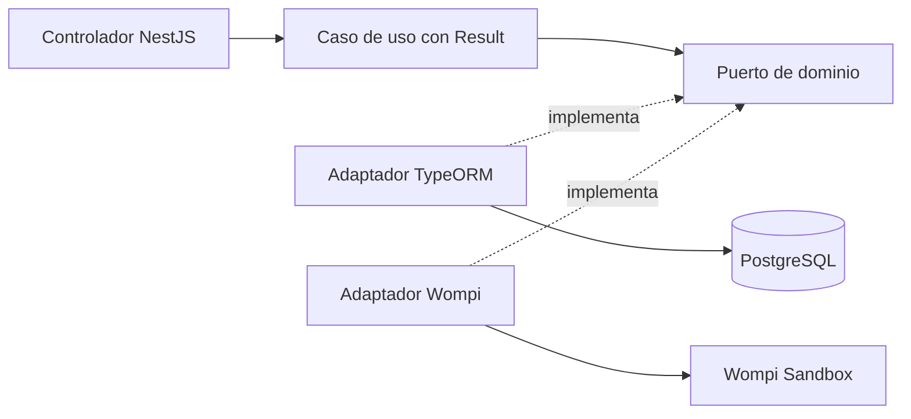

# Blush Atelier API

Backend de Blush Atelier, una tienda de cosméticos con checkout de tarjeta de crédito.
Construido con NestJS 11, TypeScript, TypeORM y PostgreSQL. Los pagos utilizan
exclusivamente Wompi Sandbox.

## Enlaces

| Servicio | URL                                                |
| -------- | -------------------------------------------------- |
| Tienda   | https://dviblid28pd4o.cloudfront.net/              |
| API      | https://blush-atelier-api.duckdns.org/api/products |
| Swagger  | https://dviblid28pd4o.cloudfront.net/api/docs      |
| OpenAPI  | https://dviblid28pd4o.cloudfront.net/api/docs-json |
| Frontend | https://github.com/blush-atelier/blush-atelier-web |

## Instalación y ejecución local

Requisitos: Node.js 22 (`.nvmrc`), npm, Docker y Docker Compose. Para WSL, Docker
debe estar disponible dentro de Ubuntu.

```bash
nvm use
npm ci
cp .env.example .env
```

Completa `.env` con la configuración local. Elige usuario y contraseña para PostgreSQL:

```dotenv
NODE_ENV=development
PORT=3000
FRONTEND_ORIGIN=http://localhost:5173
POSTGRES_HOST=localhost
POSTGRES_PORT=5433
POSTGRES_DB=blush_atelier
POSTGRES_USER=
POSTGRES_PASSWORD=
POSTGRES_SSL=false
WOMPI_ENABLED=false
```

```bash
docker compose up -d db
docker compose ps
# Ejecutar cuando db aparezca healthy:
npm run local:migrate
npm run local:seed
npm run local:dev
```

Catálogo: http://localhost:3000/api/products. Swagger: http://localhost:3000/docs.
El seed carga 22 productos de demostración y puede repetirse sin reiniciar inventario.
Los comandos `local:*` resuelven la conexión al contenedor en WSL.
`docker compose down` detiene PostgreSQL sin eliminar su volumen.
[Guía de desarrollo](docs/development.md).

## Configuración

Los nombres de variables están en `.env.example`. Los valores privados se configuran
localmente o en el servidor y nunca se versionan.

| Variables                                                                                             | Función                                                                                                   |
| ----------------------------------------------------------------------------------------------------- | --------------------------------------------------------------------------------------------------------- |
| `NODE_ENV`, `PORT`, `FRONTEND_ORIGIN`                                                                 | Entorno, puerto y origen frontend permitido                                                               |
| `POSTGRES_HOST`, `POSTGRES_PORT`, `POSTGRES_DB`, `POSTGRES_USER`, `POSTGRES_PASSWORD`, `POSTGRES_SSL` | Conexión PostgreSQL; producción exige TLS                                                                 |
| `BASE_FEE_MINOR`, `DELIVERY_FEE_MINOR`                                                                | Tarifas en centavos enteros                                                                               |
| `SWAGGER_ENABLED`                                                                                     | En producción, `true` habilita `/api/docs` y `/api/docs-json`; desarrollo conserva `/docs` y `/docs-json` |
| `WOMPI_ENABLED`                                                                                       | `true` habilita pagos Sandbox                                                                             |
| `WOMPI_API_URL`, `UAT_SANDBOX_URL`                                                                    | URL Sandbox y alternativa de configuración                                                                |
| `WOMPI_PUBLIC_KEY`, `WOMPI_PRIVATE_KEY`                                                               | Llaves de prueba del mismo ambiente                                                                       |
| `WOMPI_INTEGRITY_SECRET`, `WOMPI_EVENTS_SECRET`                                                       | Secretos de firma y autenticación de eventos                                                              |
| `UAT_URL`                                                                                             | Referencia del proveedor; no se utiliza para enviar pagos                                                 |

Para probar pagos, configura `WOMPI_ENABLED=true` y las cuatro llaves/secretos.
Destinos admitidos: `https://sandbox.wompi.co/v1` y
`https://api-sandbox.co.uat.wompi.dev/v1`. Las llaves `pub_stagtest`/`prv_stagtest`
requieren UAT Sandbox. Reinicia la API después de cambiar la configuración.

## Arquitectura y modelo de datos



Módulos `products`, `customers`, `deliveries`, `transactions` y `payments`, cada uno
con `domain`, `application` e `infrastructure`. Dominio y aplicación no importan
NestJS ni TypeORM. Los casos de uso orquestan puertos; adaptadores Repository y Unit
of Work se conectan por inyección de dependencias. Los fallos esperados usan ROP:
`Result<T,E> = { ok: true; value: T } | { ok: false; error: E }`.


| Tabla               | Responsabilidad y relación                                          |
| ------------------- | ------------------------------------------------------------------- |
| `products`          | Precio, inventario físico y reservado                               |
| `customers`         | Contacto y hash de sesión; propietario de entregas/transacciones    |
| `deliveries`        | Destinatario, dirección y estado de entrega                         |
| `transactions`      | Referencia, importes, estado, reserva e identificador del proveedor |
| `transaction_items` | Productos y cantidades del pedido, con precio conservado            |

Disponibilidad = `stock_on_hand - stock_reserved`. Importes: `BIGINT` en PostgreSQL,
`bigint` para cálculos y strings decimales en JSON; `"8990000"` son 89.900,00 COP.
Antes de enviar números a Wompi se comprueba el límite entero seguro de JavaScript.
[ERD Mermaid](docs/erd.mmd) · [Diccionario de datos](docs/data-dictionary.md).

<details>
<summary>Flujo de checkout y pago Sandbox</summary>


[Fuente del diagrama](docs/checkout-sequence.mmd).
</details>

## Endpoints

| Método | Ruta                                          | Función                                       |
| ------ | --------------------------------------------- | --------------------------------------------- |
| GET    | `/api/products`                               | Listar productos y disponibilidad             |
| GET    | `/api/products/{id}`                          | Consultar detalle                             |
| POST   | `/api/customers`                              | Registrar contacto y crear sesión             |
| POST   | `/api/deliveries`                             | Registrar dirección de entrega                |
| POST   | `/api/checkout/quote`                         | Calcular productos, tarifa base y envío       |
| POST   | `/api/transactions`                           | Crear PENDING y reservar stock                |
| GET    | `/api/transactions/{id}`                      | Consultar el pedido de la sesión              |
| GET    | `/api/payments/card-configuration`            | Obtener configuración pública de tokenización |
| POST   | `/api/transactions/{id}/payments`             | Procesar el token de tarjeta                  |
| POST   | `/api/transactions/{id}/payment-verification` | Consultar el resultado verificado             |
| POST   | `/api/payments/wompi/events`                  | Recibir eventos firmados                      |

## Cómo probar

### Catálogo y contratos

```bash
curl http://localhost:3000/api/products
curl http://localhost:3000/docs-json
```

En Swagger, usa **Try it out**. Los POST del comprador requieren
`X-Checkout-Request: 1`; el registro crea una cookie HttpOnly para los endpoints
posteriores. Crear PENDING requiere además `Idempotency-Key` y la cotización vigente.
Los esquemas de Swagger describen los cuerpos de cada solicitud.

### Pago, estado y stock

1. Realiza la compra desde el frontend con una tarjeta oficial Sandbox.
2. Copia el UUID del pedido; la referencia tiene formato `BA-UUID`.
3. Abre Swagger en el mismo navegador y host de la compra. No registres otro cliente:
   reemplazaría la sesión. Consulta `GET /api/transactions/{id}`.
4. Si permanece PENDING, consulta `POST /api/transactions/{id}/payment-verification`
   con `{}` y `X-Checkout-Request: 1`. El backend obtiene el resultado de Wompi.
5. Consulta el producto y compara la disponibilidad con la anterior a la compra.

| Caso                         | Resultado esperado                                                    |
| ---------------------------- | --------------------------------------------------------------------- |
| PENDING                      | Stock reservado; todavía no se confirma la entrega                    |
| APPROVED                     | Reserva CONFIRMED, entrega READY y stock físico descontado una vez    |
| DECLINED / ERROR             | Reserva RELEASED y stock físico conservado                            |
| Timeout                      | PENDING hasta obtener un resultado verificable; no se repite el cargo |
| Solicitud o evento duplicado | No se repiten el cargo ni los movimientos de stock                    |
| Firma de evento inválida     | HTTP 401, sin aplicar cambios                                         |

No envíes PAN/CVC por Swagger ni alteres estados en SQL. Para comprobar rechazos o
404 sin el fallback de CloudFront, utiliza la API directa en DuckDNS.
[Casos de prueba y consultas SQL](docs/checkout-testing.md).

### Pruebas automatizadas

```bash
npm run format:check
npm run lint
npm run typecheck
npm run test:cov
npm run build
```

Jest: **229 pruebas unitarias/HTTP**. Cobertura registrada: **94,21% sentencias,
90,72% ramas, 87,09% funciones y 94,20% líneas**. Umbral global: 81%.
La suite PostgreSQL cuenta con **42 pruebas**; utiliza únicamente una base local
desechable, nunca RDS. [Configuración de integración](docs/checkout-testing.md#webhook-qa-automatizado-sin-pagos-ni-rds).

## Seguridad

La tarjeta se cifra con JWE en el navegador y se tokeniza directamente en Wompi por
HTTPS. La API recibe el token, nunca PAN/CVC. Los secretos permanecen en el backend;
Redux/localStorage guardan solo referencias y progreso seguro.

El servidor valida importe, moneda, referencia y estado con Wompi. PENDING y reserva
se crean atómicamente; bloqueos e idempotencia evitan cobros o descuentos duplicados.
Los eventos validan checksum y no registran payloads ni secretos.
[Seguridad de pagos](docs/payment-security.md).

## Despliegue

Frontend en S3/CloudFront; API Docker en EC2; PostgreSQL RDS privado. CloudFront
redirige `/api/*` al origen HTTPS `blush-atelier-api.duckdns.org`.
`Dockerfile.prod` incluye el certificado CA para verificar TLS con RDS.

Con el `.env` del servidor configurado y acceso privado a RDS, los comandos de
publicación son:

```bash
docker compose -f compose.prod.yml build
docker compose -f compose.prod.yml run --rm api node scripts/migrate-prod.cjs
docker compose -f compose.prod.yml up -d
```

Las migraciones de producción requieren revisión previa. No ejecutar seed ni
rollback de RDS para probar la aplicación.

## Limitaciones conocidas

- El receptor del webhook está implementado y probado con eventos simulados. La
  emisión real desde Wompi no se confirmó por falta de acceso a la configuración
  del dashboard. El checkout consulta el estado directamente mediante la API privada.

[Requisitos](docs/requirements.md).
