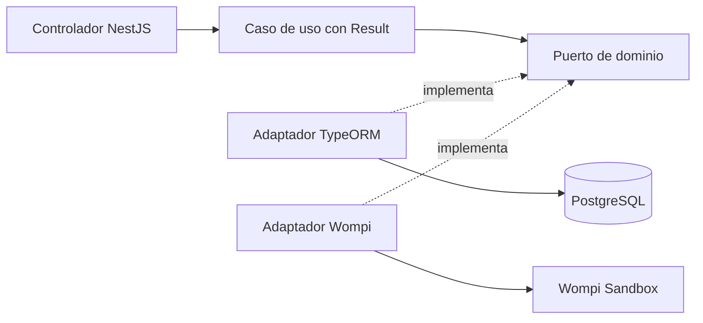
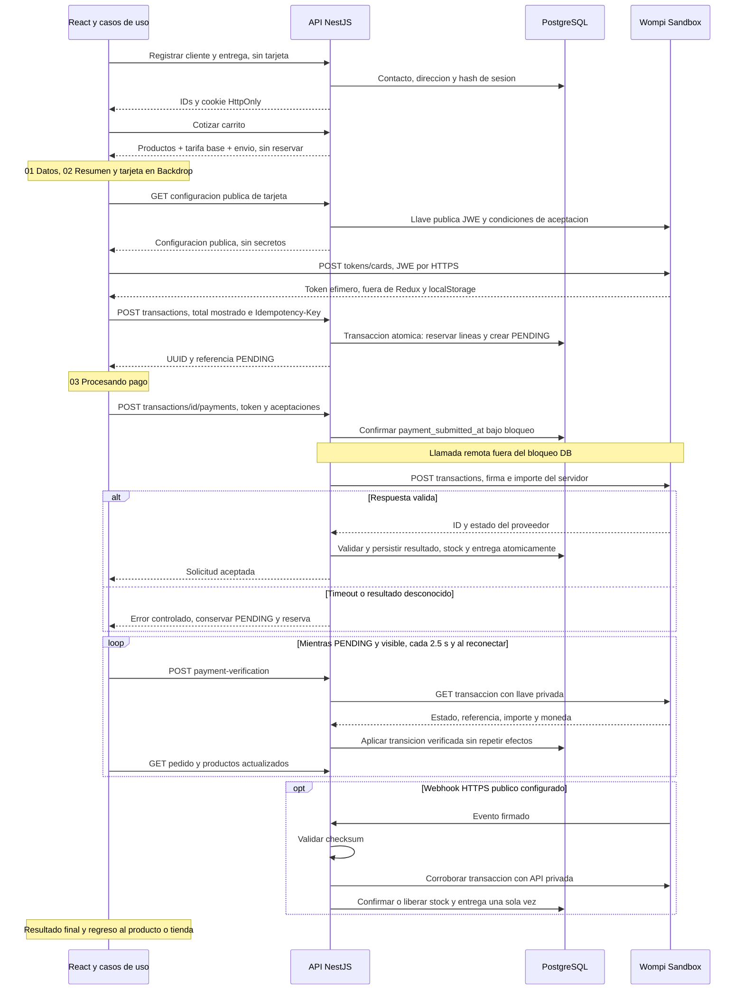

# Blush Atelier API

API de la prueba Full Stack: NestJS 11, TypeScript, TypeORM y PostgreSQL.
Pagos exclusivamente con **Wompi Sandbox**, incluso en AWS.

| Entrega     | URL                                                                        |
| ----------- | -------------------------------------------------------------------------- |
| Tienda      | [Blush Atelier](https://dviblid28pd4o.cloudfront.net/)                     |
| API pública | [Catálogo JSON](https://dviblid28pd4o.cloudfront.net/api/products)         |
| Swagger     | [Documentación interactiva](https://dviblid28pd4o.cloudfront.net/api/docs) |
| OpenAPI     | [Contrato JSON](https://dviblid28pd4o.cloudfront.net/api/docs-json)        |
| Frontend    | [blush-atelier-web](https://github.com/blush-atelier/blush-atelier-web)    |
| Backend     | [blush-atelier-api](https://github.com/blush-atelier/blush-atelier-api)    |

## Ejecutar localmente

Requiere Node 22 (`.nvmrc`), npm y Docker Compose. Son dos repositorios independientes.
Desde esta raíz:

```bash
nvm use
npm ci
cp .env.example .env
```

Completa `.env` con valores locales; elige usuario y contraseña para PostgreSQL:

```dotenv
NODE_ENV=development
PORT=3000
FRONTEND_ORIGIN=http://localhost:5173
SWAGGER_ENABLED=false
POSTGRES_HOST=localhost
POSTGRES_PORT=5433
POSTGRES_DB=blush_atelier
POSTGRES_USER=
POSTGRES_PASSWORD=
POSTGRES_SSL=false
WOMPI_ENABLED=false
```

```bash
docker compose up -d db
docker compose ps
# Cuando db este healthy:
npm run local:migrate
npm run local:seed
npm run local:dev
```

API: http://localhost:3000/api/products. Swagger: http://localhost:3000/docs;
contrato: http://localhost:3000/docs-json. Los comandos `local:*` descubren la IP de
Docker en WSL. El seed aporta 22 productos de demostración con imágenes y precios
COP de referencia; repetirlo no reinicia stock. `docker compose down` conserva datos.
[Solución de problemas](docs/development.md).

## Variables de entorno

`.env` no se versiona. Copia los nombres de `.env.example`, nunca credenciales al README.

| Variables                                                                                             | Uso                                                                                                                        |
| ----------------------------------------------------------------------------------------------------- | -------------------------------------------------------------------------------------------------------------------------- |
| `NODE_ENV`, `PORT`, `FRONTEND_ORIGIN`                                                                 | Entorno, puerto y único origen frontend autorizado; HTTPS en producción                                                    |
| `SWAGGER_ENABLED`                                                                                     | Producción: solo el valor exacto `true` publica `/api/docs` y `/api/docs-json`. Desarrollo conserva `/docs` y `/docs-json` |
| `POSTGRES_HOST`, `POSTGRES_PORT`, `POSTGRES_DB`, `POSTGRES_USER`, `POSTGRES_PASSWORD`, `POSTGRES_SSL` | Conexión PostgreSQL; producción exige TLS con certificado verificado                                                       |
| `BASE_FEE_MINOR`, `DELIVERY_FEE_MINOR`                                                                | Tarifas del servidor en centavos enteros                                                                                   |
| `WOMPI_ENABLED`                                                                                       | `true` activa Sandbox; `false` permite catálogo/checkout sin procesar pagos                                                |
| `WOMPI_PUBLIC_KEY`, `WOMPI_PRIVATE_KEY`                                                               | Llaves de prueba del mismo ambiente                                                                                        |
| `WOMPI_INTEGRITY_SECRET`, `WOMPI_EVENTS_SECRET`                                                       | Secretos de integridad y eventos, solo backend                                                                             |
| `WOMPI_API_URL`, `UAT_SANDBOX_URL`                                                                    | Destino Sandbox y alternativa cuando no se define el primero                                                               |
| `UAT_URL`                                                                                             | Referencia del proveedor; nunca se utiliza como destino de pagos                                                           |

Destinos permitidos: `https://sandbox.wompi.co/v1` y
`https://api-sandbox.co.uat.wompi.dev/v1`. Credenciales `pub_stagtest`/`prv_stagtest`
requieren el segundo. Los secretos son opacos: no les agregues prefijos.

## Arquitectura y modelo de datos



Módulos `products`, `customers`, `deliveries`, `transactions` y `payments`, cada uno
con `domain`, `application` e `infrastructure`. Dominio y aplicación no importan
NestJS ni TypeORM. Los casos de uso orquestan puertos; adaptadores Repository y Unit
of Work se conectan por inyección de dependencias. Los fallos esperados usan ROP:
`Result<T,E> = { ok: true; value: T } | { ok: false; error: E }`.


| Tabla               | Responsabilidad y relación                                          |
| ------------------- | ------------------------------------------------------------------- |
| `products`          | Precio, inventario físico y reservado                               |
| `customers`         | Contacto y hash de sesión; propietario de entregas/transacciones    |
| `deliveries`        | Destinatario, dirección y estado de entrega                         |
| `transactions`      | Referencia, importes, estado, reserva e identificador del proveedor |
| `transaction_items` | Productos y cantidades del pedido, con precio conservado            |

Disponibilidad = `stock_on_hand - stock_reserved`. Importes: `BIGINT` en PostgreSQL,
`bigint` para cálculos y strings decimales en JSON; `"8990000"` son 89.900,00 COP.
Antes de enviar números a Wompi se comprueba el límite entero seguro de JavaScript.
[ERD Mermaid](docs/erd.mmd) · [Diccionario de datos](docs/data-dictionary.md).

<details>
<summary>Flujo de checkout y pago Sandbox</summary>



[Fuente del diagrama](docs/checkout-sequence.mmd).
</details>

## API y seguridad del pago

| Método | Endpoint                                      | Uso                                                          |
| ------ | --------------------------------------------- | ------------------------------------------------------------ |
| GET    | `/api/products`, `/api/products/{id}`         | Catálogo, detalle y stock disponible                         |
| POST   | `/api/customers`                              | Registrar contacto y crear cookie de sesión                  |
| POST   | `/api/deliveries`                             | Registrar entrega de la sesión                               |
| POST   | `/api/checkout/quote`                         | Cotizar sin reservar                                         |
| POST   | `/api/transactions`                           | Crear PENDING y reservar; exige `Idempotency-Key`            |
| GET    | `/api/transactions/{id}`                      | Consultar pedido propio                                      |
| GET    | `/api/payments/card-configuration`            | Configuración pública de tokenización                        |
| POST   | `/api/transactions/{id}/payments`             | Pagar con token, cuotas y aceptaciones                       |
| POST   | `/api/transactions/{id}/payment-verification` | Consultar estado verificado en Wompi                         |
| POST   | `/api/payments/wompi/events`                  | Recibir evento firmado, sin cookie ni cabecera del comprador |

Los POST del comprador requieren `X-Checkout-Request: 1`; después del registro,
también la cookie HttpOnly. Swagger documenta la cabecera. No introduzcas tarjetas
en Swagger ni registres otro cliente para consultar un pedido de tu sesión actual.
La ruta `payment-session` conserva compatibilidad con intentos del Widget anterior;
el flujo de la tienda utiliza tokenización propia.

PAN/CVC viven temporalmente en el navegador: Web Crypto genera JWE y lo envía por
HTTPS directamente a Wompi. La API recibe únicamente el token; nunca PAN/CVC.
Redux/localStorage conservan solo progreso seguro y referencias. No se guardan ni
registran tarjetas o secretos. El servidor calcula precios/tarifas/stock y verifica
ID, referencia, moneda e importe con la API privada; una redirección no prueba pago.

PENDING reserva todas las líneas atómicamente. `payment_submitted_at` se confirma
antes del cargo: reintentar no crea otro. APPROVED confirma stock y entrega READY;
DECLINED/ERROR liberan reserva. Timeout conserva PENDING hasta reconciliar.
Los eventos validan checksum y se aplican bajo bloqueo: un duplicado final no repite
efectos. Logs JSON contienen correlación, duración y resultado, sin payload ni secretos.
[Detalles de seguridad](docs/payment-security.md).

## Pruebas y webhook sin dashboard

```bash
npm run lint
npm run typecheck
npm run test:cov
npm run build
```

Última medición: **229 pruebas unitarias/HTTP, 20 suites**, y **42 pruebas de
integración PostgreSQL**, estas últimas en un contenedor desechable con Wompi simulado.
Cobertura: **94,21% sentencias · 90,72% ramas · 87,09% funciones · 94,20% líneas**.
Jest exige 81% en las cuatro métricas e incluye todo `src`.

[Guía de pruebas](docs/checkout-testing.md) incluye ejecución aislada, rollback,
idempotencia, consultas SQL de lectura y replay firmado de una transacción existente.
El replay no crea pagos, pero puede reconciliar el pedido: no se ejecuta en AWS sin
autorización. Por defecto el comando solo muestra el plan. Sin acceso al dashboard
no se puede acreditar que Wompi tenga configurada nuestra URL y notifique automáticamente.

## AWS y CI

Frontend: S3/CloudFront. Backend: Docker en EC2 y PostgreSQL RDS con TLS.
CloudFront enruta `/api/*` al origen de la API y el resto al frontend. Las URLs de
arriba respondieron HTTP 200; el webhook rechazó un cuerpo sin firma con 401.
Eso no reemplaza una prueba de compra completa en AWS.

`Dockerfile.prod` incluye el certificado CA de RDS. Para reproducir el backend,
configura el `.env` del servidor, acceso de red privado a RDS y origen frontend HTTPS.
Solo durante una entrega autorizada:

```bash
docker compose -f compose.prod.yml build
docker compose -f compose.prod.yml run --rm api node scripts/migrate-prod.cjs
docker compose -f compose.prod.yml up -d
```

No ejecutar rollback/seed de producción como prueba. Los secretos permanecen en
runtime del servidor; no se incorporan a imágenes ni al frontend.

GitHub Actions ejecuta instalación, formato, lint, typecheck, Jest con cobertura,
integración PostgreSQL y build. Promoción por PR:
`feature/* → development → staging → production`. No hay despliegue automático
habilitado. [Pipeline](docs/pipeline.md) · [Evidencia y pendientes](docs/verification.md)
· [Requisitos](docs/requirements.md).
