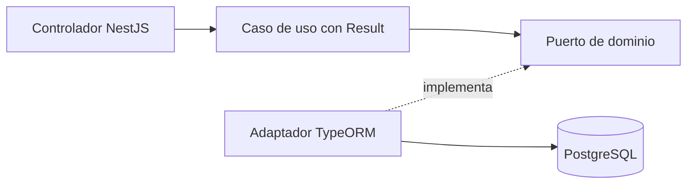
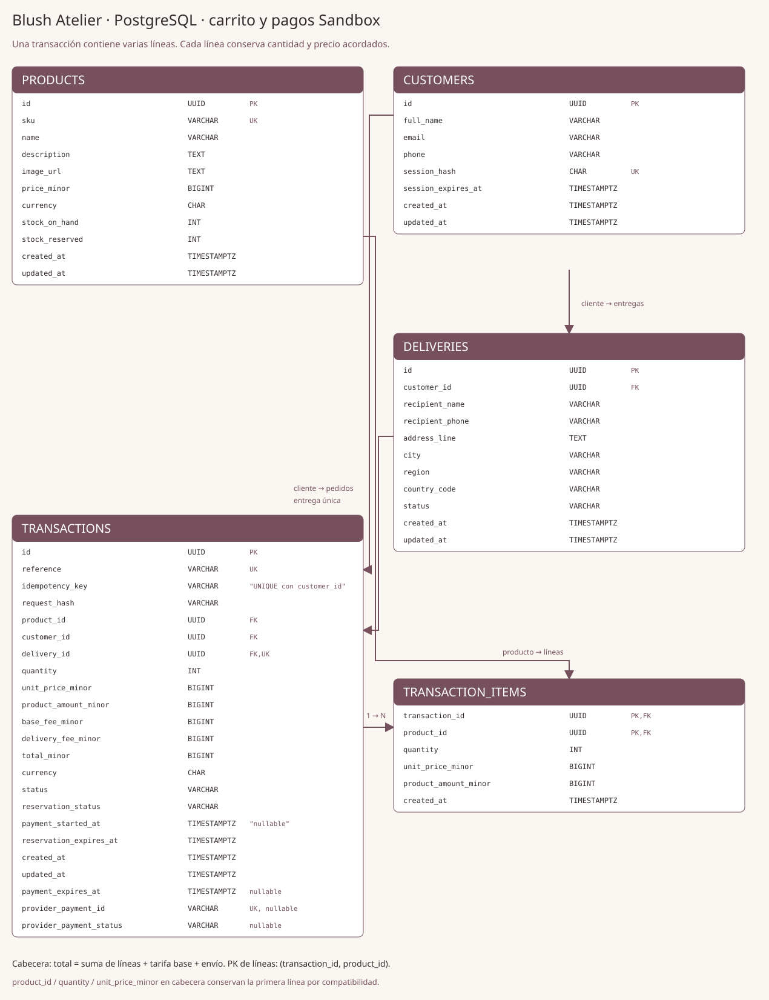

# Blush Atelier API

Backend de la prueba Full Stack: NestJS, TypeScript, PostgreSQL y TypeORM.
Frontend independiente: [blush-atelier-web](https://github.com/blush-atelier/blush-atelier-web).
Incluye catálogo, carrito de varios productos, cliente, entrega, cotización y una transacción PENDING con reserva atómica de stock.
El procesamiento de pagos y el despliegue siguen pendientes.
Wompi se usará exclusivamente en Sandbox en todos los ambientes.

## Ejecutar localmente

Requisitos: WSL Ubuntu, Node 22.23.3 (`.nvmrc`) y Docker Compose disponible en WSL.
Ejecuta desde la raíz del repositorio:

```bash
nvm use
npm ci
cp .env.example .env
```

Completa `.env` así y elige tu usuario y contraseña locales en los dos campos vacíos:

```dotenv
NODE_ENV=development
PORT=3000
FRONTEND_ORIGIN=http://localhost:5173
POSTGRES_HOST=localhost
POSTGRES_PORT=5433
POSTGRES_DB=blush_atelier
POSTGRES_USER=
POSTGRES_PASSWORD=
POSTGRES_SSL=false
```

`.env` no se versiona. Luego levanta PostgreSQL, crea las tablas, carga productos y arranca la API:

```bash
docker compose up -d db
docker compose ps
npm run local:migrate
npm run local:seed
npm run local:dev
```

Espera a que `db` aparezca como `healthy` antes de ejecutar la migración.
Los comandos local:* detectan la IP actual del contenedor en WSL sin modificar .env.
El seed carga 20 productos reales (MAC, Too Faced, Bloomshell y Atenea) con precios de referencia COP y fotos, además de los 2 ficticios previos; inventario de demostración. Se puede repetir sin reiniciar stock ni precios. [Fuentes](docs/decisions-and-interview-notes.md#catálogo-de-demostración--13112026). `docker compose down` detiene la BD conservando el volumen.
[Guía local y solución de errores](docs/development.md).

## Probar con Swagger

Abre [http://localhost:3000/docs](http://localhost:3000/docs).
Expande un endpoint, pulsa **Try it out** y luego **Execute**. Los productos son públicos; el checkout usa una cookie HttpOnly creada al registrar el cliente.

| Método | Endpoint                               | Función                                            |
| ------ | -------------------------------------- | -------------------------------------------------- |
| GET    | `/api/products` y `/api/products/{id}` | Catálogo y stock disponible                        |
| POST   | `/api/customers`                       | Registrar comprador y crear cookie de sesión       |
| POST   | `/api/deliveries`                      | Guardar entrega para esa sesión                    |
| POST   | `/api/checkout/quote`                  | Cotizar sin reservar                               |
| POST   | `/api/transactions`                    | Crear PENDING y reservar con Idempotency-Key       |
| GET    | `/api/transactions/{id}`               | Reanudar y consultar el estado de la propia compra |

En cada POST usa `X-Checkout-Request: 1`. Swagger muestra la cabecera; registra primero
el cliente para que el navegador guarde la cookie. No introduzcas tarjetas.
[Ejemplos para probar el flujo](docs/checkout-testing.md).

UUID inválido: 400; producto inexistente: 404; almacenamiento no disponible: 503.
Contrato OpenAPI: [http://localhost:3000/docs-json](http://localhost:3000/docs-json).
Swagger ya está configurado; sus rutas no llevan el prefijo `/api`.

## Arquitectura y modelo de datos



Organización por módulo: `domain`, `application` e `infrastructure`.
Dominio y aplicación no dependen de NestJS ni TypeORM; el controlador traduce Result a HTTP.
La reserva y la transacción se guardan juntas; una clave repetida no duplica stock.
Las reservas sin pago vencen en 15 minutos; su liberación se evalúa al cotizar, crear
o consultar transacciones. Cada pedido conserva sus líneas en `transaction_items`; las tarifas se aplican una sola vez.
[Decisiones y notas para entrevista](docs/decisions-and-interview-notes.md).



Disponibilidad = `stock_on_hand - stock_reserved`. Los importes son centavos:
`BIGINT` en PostgreSQL, `bigint` para cálculos y string en JSON;
`"8990000"` representa 89.900,00 COP.
[ERD Mermaid](docs/erd.mmd), [diccionario de datos](docs/data-dictionary.md) y
[modelo futuro de checkout y relaciones](docs/checkout-model.mmd).

## Pruebas

```bash
npm run format:check
npm run lint
npm run typecheck
npm run test:cov
npm run build
```

Resultado medido: **111 pruebas unitarias/HTTP y 23 de integración correctas**.
Cobertura Jest del backend: sentencias **97,57%**, ramas **96,41%**,
funciones **95,68%** y líneas **97,30%**; umbral obligatorio configurado en 81%.
La integración usa una base desechable separada: [cómo ejecutarla](docs/development.md#pruebas-de-integración).
[Evidencia y limitaciones](docs/verification.md). El frontend mide su cobertura en su propio repositorio.

## CI/CD y entrega

Promoción por PR: `feature/* → development → staging → production`.
Development es local; staging valida; production será la entrega AWS.
GitHub Actions configura instalación, formato, lint, typecheck, Jest con cobertura,
integración PostgreSQL y build. [Pipeline](docs/pipeline.md).

AWS previsto: Lambda + API Gateway y PostgreSQL privado; frontend en S3 + CloudFront.
Primero se evaluarán costos; no se crean tres infraestructuras completas.
**URLs públicas de API y Swagger: pendientes de despliegue y verificación.**
PostgreSQL en Docker y los comandos locales están verificados; el contenedor de la API,
la primera ejecución de CI remoto y las protecciones de ramas siguen pendientes.
[Checklist de aceptación](docs/acceptance-checklist.md).

## Protección de información

La API actual rechaza campos de tarjeta y no los refleja en errores. El futuro flujo
enviará la tarjeta directamente a Wompi y el backend trabajará solo con su token.
La cookie del checkout es HttpOnly; precio, stock y estado dependen del servidor.
[Explicación de tarjeta, token y sesión](docs/payment-security.md).

[Auditoría de entrega y plan mínimo](docs/delivery-audit.md).
