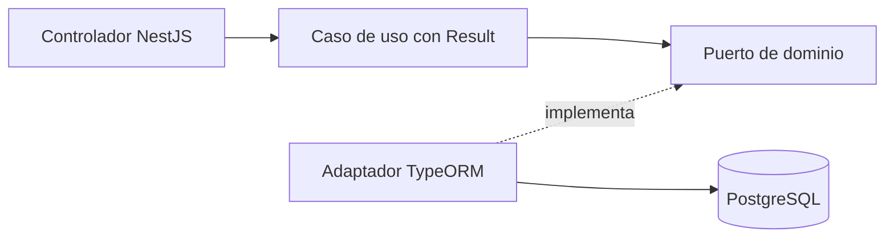

# Blush Atelier API

Backend de la prueba Full Stack: NestJS, TypeScript, PostgreSQL y TypeORM.
Frontend independiente: [blush-atelier-web](https://github.com/blush-atelier/blush-atelier-web).
Incluye catálogo, carrito de varios productos, cliente, entrega, cotización y una transacción PENDING con reserva atómica de stock.
La integración Wompi Sandbox está implementada para pruebas locales; falta validarla
con credenciales del comercio y verificar el despliegue AWS.
Wompi se usará exclusivamente en Sandbox en todos los ambientes.

## Ejecutar localmente

Requisitos: WSL Ubuntu, Node 22.23.3 (`.nvmrc`) y Docker Compose disponible en WSL.
Ejecuta desde la raíz del repositorio:

```bash
nvm use
npm ci
cp .env.example .env
```

Completa `.env` así y elige tu usuario y contraseña locales en los dos campos vacíos:

```dotenv
NODE_ENV=development
PORT=3000
FRONTEND_ORIGIN=http://localhost:5173
POSTGRES_HOST=localhost
POSTGRES_PORT=5433
POSTGRES_DB=blush_atelier
POSTGRES_USER=
POSTGRES_PASSWORD=
POSTGRES_SSL=false
```

`.env` no se versiona. Luego levanta PostgreSQL, crea las tablas, carga productos y arranca la API:

```bash
docker compose up -d db
docker compose ps
npm run local:migrate
npm run local:seed
npm run local:dev
```

Espera a que `db` aparezca como `healthy` antes de ejecutar la migración.
Los comandos local:* detectan la IP actual del contenedor en WSL sin modificar .env.
El seed carga 20 productos reales (MAC, Too Faced, Bloomshell y Atenea) con precios de referencia COP y fotos, además de los 2 ficticios previos; inventario de demostración. Se puede repetir sin reiniciar stock ni precios. [Fuentes](docs/decisions-and-interview-notes.md#catálogo-de-demostración--13112026). `docker compose down` detiene la BD conservando el volumen.
[Guía local y solución de errores](docs/development.md).

## Probar con Swagger

Abre [http://localhost:3000/docs](http://localhost:3000/docs).
Expande un endpoint, pulsa **Try it out** y luego **Execute**. Los productos son públicos; el checkout usa una cookie HttpOnly creada al registrar el cliente.

| Método | Endpoint                               | Función                                            |
| ------ | -------------------------------------- | -------------------------------------------------- |
| GET    | `/api/products` y `/api/products/{id}` | Catálogo y stock disponible                        |
| POST   | `/api/customers`                       | Registrar comprador y crear cookie de sesión       |
| POST   | `/api/deliveries`                      | Guardar entrega para esa sesión                    |
| POST   | `/api/checkout/quote`                  | Cotizar sin reservar                               |
| POST   | `/api/transactions`                    | Crear PENDING y reservar con Idempotency-Key       |
| GET    | `/api/transactions/{id}`               | Reanudar y consultar el estado de la propia compra |

En cada POST usa `X-Checkout-Request: 1`. Swagger muestra la cabecera; registra primero
el cliente para que el navegador guarde la cookie. No introduzcas tarjetas en Swagger. La captura se hace únicamente en el Widget alojado de Wompi.
[Ejemplos para probar el flujo](docs/checkout-testing.md).

UUID inválido: 400; producto inexistente: 404; almacenamiento no disponible: 503.
Contrato OpenAPI: [http://localhost:3000/docs-json](http://localhost:3000/docs-json).
Swagger ya está configurado; sus rutas no llevan el prefijo `/api`.

## Arquitectura y modelo de datos



Organización por módulo: `domain`, `application` e `infrastructure`.
Dominio y aplicación no dependen de NestJS ni TypeORM; el controlador traduce Result a HTTP.
La reserva y la transacción se guardan juntas; una clave repetida no duplica stock.
Las reservas sin pago vencen en 15 minutos; su liberación se evalúa al cotizar, crear
o consultar transacciones. Cada pedido conserva sus líneas en `transaction_items`; las tarifas se aplican una sola vez.
[Decisiones y notas para entrevista](docs/decisions-and-interview-notes.md).

`payments/domain` decide transiciones con Result; `application` prepara/verifica pagos
y procesa eventos; `infrastructure` implementa Wompi, HTTP y persistencia. La llamada
al proveedor queda fuera del bloqueo DB; la confirmación/liberación de todas las líneas
y la entrega se guardan atómicamente. Duplicados no repiten el movimiento de stock.


Disponibilidad = `stock_on_hand - stock_reserved`. Los importes son centavos:
`BIGINT` en PostgreSQL, `bigint` para cálculos y string en JSON;
`"8990000"` representa 89.900,00 COP.
[ERD Mermaid](docs/erd.mmd), [diccionario de datos](docs/data-dictionary.md) y
[modelo futuro de checkout y relaciones](docs/checkout-model.mmd).

## Pruebas

```bash
npm run format:check
npm run lint
npm run typecheck
npm run test:cov
npm run build
```

Resultado medido: **186 pruebas unitarias/HTTP y 36 de integración PostgreSQL correctas**.
Cobertura Jest del backend: sentencias **93,82%**, ramas **89,57%**,
funciones **87,65%** y líneas **93,72%**; umbral obligatorio configurado en 81%.
La integración usa una base desechable separada: [cómo ejecutarla](docs/development.md#pruebas-de-integración).
[Evidencia y limitaciones](docs/verification.md). El frontend mide su cobertura en su propio repositorio.

## CI/CD y entrega

Promoción por PR: `feature/* → development → staging → production`.
Development es local; staging valida; production será la entrega AWS.
GitHub Actions configura instalación, formato, lint, typecheck, Jest con cobertura,
integración PostgreSQL y build. [Pipeline](docs/pipeline.md).

AWS previsto: Lambda + API Gateway y PostgreSQL privado; frontend en S3 + CloudFront.
Primero se evaluarán costos; no se crean tres infraestructuras completas.
**URLs públicas de API y Swagger: pendientes de despliegue y verificación.**
PostgreSQL en Docker y los comandos locales están verificados; el contenedor de la API,
la primera ejecución de CI remoto y las protecciones de ramas siguen pendientes.
[Checklist de aceptación](docs/acceptance-checklist.md).

## Wompi Sandbox: configurar y probar

En el `.env` **del backend**, configura `WOMPI_ENABLED=true` y completa estos nombres
con las llaves y secretos del ambiente Sandbox de tu comercio:

- `WOMPI_PUBLIC_KEY`: llave de prueba `pub_test_` o `pub_stagtest`.
- `WOMPI_PRIVATE_KEY`: llave del mismo ambiente, `prv_test_` o `prv_stagtest`.
- `WOMPI_INTEGRITY_SECRET`: secreto de integridad entregado para ese ambiente, sin modificarlo.
- `WOMPI_EVENTS_SECRET`: secreto de eventos entregado para ese ambiente, sin modificarlo.

Configura el destino con `WOMPI_API_URL`. Para las credenciales de la prueba:

```dotenv
UAT_URL=https://api.co.uat.wompi.dev/v1
UAT_SANDBOX_URL=https://api-sandbox.co.uat.wompi.dev/v1
WOMPI_API_URL=https://api-sandbox.co.uat.wompi.dev/v1
```

Sin WOMPI_API_URL se toma UAT_SANDBOX_URL y, si tampoco existe, el Sandbox público.
UAT_URL queda como referencia: no es el destino activo de esta integración Sandbox.
Los destinos permitidos son Sandbox público y UAT Sandbox; no se envían llaves a
URLs arbitrarias. El frontend usa el Widget UAT `https://checkout.co.uat.wompi.dev/widget.js`
con llaves stagtest; puede configurarse mediante VITE_WOMPI_WIDGET_URL. Cambiar
la API sin cambiar el Widget mezcla ambientes.

No compartas ni versiones los valores. No son el usuario/contraseña del dashboard.
Reinicia API y frontend después de configurar. Sin habilitar Wompi, catálogo y reservas
funcionan; el intento de pago devuelve `PaymentNotConfigured`. No se instalaron paquetes
nuevos; se usa fetch/crypto de Node y el script oficial alojado del Widget.

| Método | Endpoint                                      | Uso                                                                          |
| ------ | --------------------------------------------- | ---------------------------------------------------------------------------- |
| POST   | `/api/transactions/{id}/payment-session`      | Sesión firmada para un PENDING propio; cuerpo `{ "method": "CARD" }`         |
| POST   | `/api/transactions/{id}/payment-verification` | Consultar al proveedor; `{}` o `{ "providerPaymentId": "ID_DEL_PROVEEDOR" }` |
| POST   | `/api/payments/wompi/events`                  | Webhook firmado de Wompi, sin cookie ni cabecera del comprador               |

Los dos primeros requieren cookie y `X-Checkout-Request: 1`. Después de verificar,
GET `/api/transactions/{id}` muestra el estado guardado por el servidor. No envíes
status, importe ni tarjeta a la verificación: no forman parte de su contrato.

Prueba en el frontend: carrito → entrega → resumen/Backdrop → Continuar con el pago.
Se crea PENDING antes de abrir Wompi. Elige tarjeta y usa exclusivamente los
[datos oficiales de Sandbox](https://docs.wompi.co/docs/colombia/datos-de-prueba-en-sandbox/).
Revisa aprobado, rechazo, cierre sin pagar y recuperación tras F5; el estado mostrado
proviene del backend, no del callback. Un rechazo libera reserva; aprobación confirma
stock y deja entrega READY; timeout conserva PENDING. No reintentes con otra compra
si el resultado todavía es desconocido.

Para recibir eventos reales, configura en el dashboard Sandbox una URL HTTPS pública
que llegue a `/api/payments/wompi/events` de esta API (AWS actualizado o un túnel local
que controles). Wompi no puede llamar a localhost. El callback permite probar el pago
local, pero refrescar durante el Widget requiere webhook accesible para no perder su
resultado. Si falla la respuesta de verificación, el frontend conserva solo el ID del
proveedor para reconsultarlo; también puedes reconciliarlo desde Swagger con ese ID.
Un intento iniciado sin resultado verificable conserva stock para evitar sobreventa;
no se libera automáticamente por vencer el reloj.

El número completo y CVV se recogen en el formulario alojado de Wompi, no en nuestra
API, Redux, localStorage o logs. La API firma con secretos backend, valida checksum
con comparación constante y consulta el estado con llave privada. BIGINT/bigint y
strings JSON conservan precisión; antes de convertir al número requerido por el Widget
se comprueba Number.MAX_SAFE_INTEGER.

Evidencia actual: proveedor simulado en Jest/Chrome y stock real en PostgreSQL local.
**Pago real Sandbox con tus credenciales, webhook público y AWS: pendientes de validación.**
Documentación oficial: [Widget](https://docs.wompi.co/docs/colombia/widget-checkout-web/),
[eventos](https://docs.wompi.co/docs/colombia/eventos/) y
[consulta backend](https://docs.wompi.co/docs/colombia/seguimiento-de-transacciones/).
